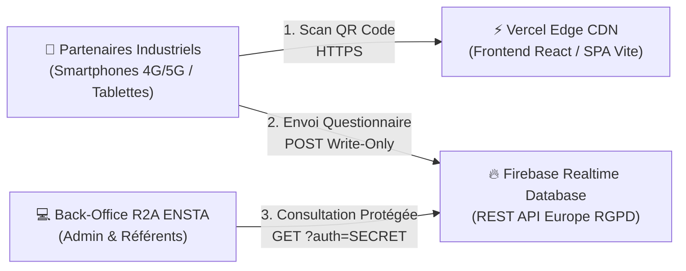

# GUIDE DE DÉPLOIEMENT CLOUD 24/7 (VERCEL + FIREBASE)
## Plateforme Technologique R2A — Roues Auto-Adaptatives (ENSTA Bretagne)

Ce guide permet à l'équipe projet (Magda Bihan, Marc Bonnafoux, Mathéo Joly) et aux référents ENSTA de déployer la plateforme en ligne **en moins de 10 minutes**, avec une disponibilité permanente **24h/24 et 7j/7**, sans qu'aucun PC ne doive rester allumé.

---

## 🏗️ Architecture Cloud 100 % Serverless (0 € / Forfaits Gratuits)



- **Hébergement Frontend (Vercel)** : CDN mondial ultra-rapide avec certificat SSL automatique (`https://roue-adaptative-ensta.vercel.app`).
- **Base de Données Cloud (Firebase Realtime Database REST API)** : Collecte directe des questionnaires sans serveur intermédiaire (architecture Write-Only imperméable, zéro fuite).
- **Sécurité & Confidentialité** : Règles de sécurité Firebase empêchant tout visiteur de lire les réponses des concurrents ou le CRM.

---

## Étape 1 : Création du Projet Firebase (2 minutes)

1. Rendez-vous sur la **[Console Firebase](https://console.firebase.google.com/)** et connectez-vous avec votre compte Google.
2. Cliquez sur **« Ajouter un projet »** (ou *Create a project*).
3. Nommez le projet (ex. `roue-adaptative-ensta` ou `r2a-ensta-2026`).
4. À l'étape Google Analytics, vous pouvez désactiver Analytics (non nécessaire) puis cliquer sur **« Créer un projet »**.
5. Patientez quelques secondes jusqu'à la confirmation de création.

---

## Étape 2 : Création de la Realtime Database en Europe (2 minutes)

1. Dans le menu latéral gauche de Firebase, déroulez **Génération** (ou *Build*) et cliquez sur **« Realtime Database »**.
2. Cliquez sur le bouton **« Créer une base de données »** (*Create Database*).
3. **Emplacement de la base (TRÈS IMPORTANT)** :
   - Sélectionnez **Belgique (`europe-west1`)** pour garantir la conformité RGPD et une latence minimale en France.
4. Cliquez sur **Suivant**.
5. À l'écran des règles de sécurité, cochez **« Démarrer en mode verrouillé »** (*Start in locked mode*) puis cliquez sur **Activer**.

---

## Étape 3 : Configuration des Règles de Sécurité Write-Only (1 minute)

Les règles de sécurité garantissent que n'importe quel partenaire peut envoyer son questionnaire (écriture), mais qu'**aucun visiteur public ne peut lire les réponses des autres entreprises**.

1. Dans votre Realtime Database, cliquez sur l'onglet **« Règles »** (*Rules*).
2. Remplacez l'intégralité du contenu par les règles suivantes :

```json
{
  "rules": {
    "responses": {
      ".write": true,
      ".read": "auth != null"
    },
    "validations": {
      ".write": "auth != null",
      ".read": true
    }
  }
}
```

3. Cliquez sur **« Publier »** (*Publish*).

> [!NOTE]
> - `.write: true` sur `/responses` : les visiteurs peuvent enregistrer leurs réponses sans compte Firebase.
> - `.read: "auth != null"` : la lecture des réponses est formellement bloquée pour le public et réservée au Back-Office via la clé secrète.

---

## Étape 4 : Récupération de l'URL et du Secret de Base de Données (2 minutes)

### 1. URL de la Base de Données
- Retournez sur l'onglet **« Données »** (*Data*) de la Realtime Database.
- Copiez l'URL affichée tout en haut (au-dessus de la racine de l'arborescence).
- Elle ressemble à :
  ```text
  https://r2a-ensta-default-rtdb.europe-west1.firebasedatabase.app
  ```
  *(Supprimez le slash `/` final si présent).*

### 2. Secret de la Base de Données (pour le Back-Office)
- Cliquez sur l'icône ⚙️ (engrenage) en haut à gauche à côté de *Vue d'ensemble du projet*, puis sélectionnez **« Paramètres du projet »** (*Project settings*).
- Cliquez sur l'onglet **« Comptes de service »** (*Service accounts*).
- Dans le sous-menu de gauche de cette page, cliquez sur **« Secrets de base de données »** (*Database secrets*).
- Cliquez sur **« Afficher »** à côté du secret généré et copiez cette clé secrète.

---

## Étape 5 : Déploiement du Frontend sur Vercel (3 minutes)

1. Rendez-vous sur **[Vercel](https://vercel.com/)** et connectez-vous (avec votre compte GitHub).
2. Cliquez sur **« Add New... »** > **« Project »**.
3. Importez le dépôt GitHub contenant le code du projet.
4. Dans les paramètres du projet Vercel (*Configure Project*) :
   - **Framework Preset** : `Vite` (détecté automatiquement).
   - **Root Directory** : Si le projet est dans un sous-dossier, cliquez sur *Edit* et sélectionnez `roue-adaptative-ensta`. Si le projet est à la racine du dépôt, laissez la racine `./`.
   - **Build Command** : `npm run build`
   - **Output Directory** : `dist`
5. Déroulez la section **« Environment Variables »** et ajoutez ces 3 variables obligatoires :

| Variable d'Environnement | Valeur | Description |
| :--- | :--- | :--- |
| `VITE_FIREBASE_URL` | `https://votre-projet-default-rtdb.europe-west1.firebasedatabase.app` | URL copiée à l'Étape 4.1 |
| `VITE_FIREBASE_SECRET` | `votre_secret_de_base_copie_a_l_etape_4.2` | Clé secrète d'authentification Back-Office |
| `VITE_ADMIN_PASSCODE` | `ENSTA2026` | Mot de passe de connexion au Back-Office |
| `VITE_PROFESSOR_CODE` | `R2A-PROF-2026` | *(Optionnel)* Code de validation Enseignants ENSTA |
| `VITE_TEAM_CODE` | `ENSTA-R2A-2026` | *(Optionnel)* Code de validation Équipe Projet |

6. Cliquez sur le bouton **« Deploy »**.
7. Après environ 45 secondes, votre application est en ligne avec son URL publique (ex. `https://roue-adaptative-ensta.vercel.app`) !

---

## Étape 6 : Vérification en Ligne & Utilisation des QR Codes

1. Ouvrez l'URL Vercel dans votre navigateur (ex. `https://roue-adaptative-ensta.vercel.app`).
2. Ouvrez le **Back-Office** (icône en haut à droite de la barre de navigation) et saisissez `ENSTA2026`.
3. Allez dans l'onglet **« Données & Sauvegarde »** :
   - Le statut vert affiche : **`🟢 Hébergement Cloud 24/7 Actif (Vercel + Firebase) : QR Codes synchronisés`**.
   - Les QR Codes pointent automatiquement vers votre URL Vercel mondiale sans aucun réglage manuel.
4. **Test de soumission sur smartphone** :
   - Scannez le **Lien 1** (Questionnaire direct sans biais) avec votre smartphone en 4G/5G.
   - Remplissez les 4 étapes et validez.
   - Ouvrez la console Firebase Realtime Database : la réponse apparaît instantanément sous le nœud `/responses` !
   - Dans le Back-Office, cliquez sur **« Actualiser Serveur PC »** : la réponse et le contact CRM associé s'affichent immédiatement.

---

## 🛡️ Résumé des Protections Actives

1. **Zéro PC Allumé** : L'infrastructure tourne 24h/24 dans le cloud Vercel + Firebase sans interruption.
2. **Architecture Write-Only Sécurisée** : Les partenaires ne peuvent faire que des `POST /responses.json`. Même en inspectant le code du navigateur, aucun client ne peut accéder aux réponses des autres entreprises.
3. **Triple Sauvegarde Préservée** : En cas de coupure de réseau temporaire dans un champ ou une carrière, le navigateur met la réponse en attente dans `localStorage` (`ensta_pending_submissions`) et ré-émet automatiquement dès le retour de la connexion 4G/5G.
4. **Justificatif Individuel `.json`** : Chaque répondant peut télécharger sa preuve de participation horodatée en 1 clic.

